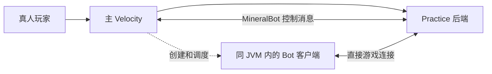

# MineralBot-Velocity

基于 Mineral-Bot 的 Minecraft Practice 对战机器人项目，面向 MiCet.cc 的 BotDuel 场景开发。项目将修改后的 Minecraft **1.7.10 客户端**嵌入 Velocity 进程，在同一个 JVM 内运行多个无界面 Bot，由客户端处理移动、碰撞、背包和游戏数据包，再通过 AI 目标系统执行对战行为。

**使用前请阅读 [LICENSE](LICENSE)。** 本项目采用 Mineral Non-Commercial Public License（MNPL-1.2），原作者为 Mineral。使用、修改和分发须遵守其中的个人使用范围、商业及组织使用限制、署名和修改源码公开要求。

## 功能

- **Practice 对战策略**：按 kit 分配近战、治疗、药水、珍珠、钓鱼竿、食物和装备管理等目标。
- **三档难度**：`noob`、`normal`、`pro`，分别配置点击速度、瞄准、攻击距离、投掷精度等参数。
- **Party 对战**：同步初始目标与友军 UUID，支持动态选敌和友军攻击保护。
- **地形导航**：分 tick 寻路、绕障、跳跃、下落、游泳，以及经后端授权和确认的挖掘、搭路与垫高。
- **BedFight 策略**：结合后端同步的床、复活和淘汰状态，在拆床与交战之间切换。
- **连接与生命周期管理**：签名身份准入、启动重试、请求取消、断线清理、共享游戏循环线程池和诊断日志。

### Kit 策略

kit 名称在匹配前会转为小写，并移除空格和下划线。以下为当前 `PracticeAI` 的主要分配规则：

| Kit / 匹配名称 | 主要行为 |
| --- | --- |
| NoDebuff / NoMisplace | 近战、治疗药水、增益药水、珍珠和进食 |
| Debuff | 在 NoDebuff 类策略上增加负面药水 |
| BuildUHC / UHC | 近战、钓鱼竿、金头/金苹果及水/岩浆操作 |
| SG / SurvivalGames | 近战、钓鱼竿、治疗药水、金苹果和进食 |
| Soup / KitMap | 蘑菇汤治疗、丢弃空碗和近战 |
| Gapple / Diamond | 增益药水、附魔金苹果、装备管理和近战 |
| Boxing / Sumo | 选择装备方案后使用近战目标 |
| Axe | 装备管理、进食和近战武器选择 |
| Combo / NoDelay | 增益药水、附魔金苹果和近战 |
| Classic / Archer | 金苹果、进食、钓鱼竿和近战 |
| BedFight | 进食、装备管理及专用拆床/交战策略 |
| Spleef | 当前分配基础近战目标 |
| 其他名称 | 默认治疗、进食、装备管理和近战策略 |

这些名称表示 AI 目标的分配方式；例如 `Archer` 当前使用 Classic 策略，并不包含独立射箭目标。具体规则见 [PracticeAI.kt](bot-intelligence/src/main/java/gg/mineral/bot/ai/goal/practice/PracticeAI.kt)。

## 运行架构

Velocity 加载控制插件，通过 `MineralBot` 插件消息通道与 Practice 后端交互。收到创建请求并通过签名身份准入后，Bot 使用 Velocity 中注册的后端地址，**直接连接 Practice**，通过兼容 Bungee 转发的握手传递 UUID、IP、皮肤属性及 token。



Bot 的游戏连接不经过主 Velocity 的玩家连接流程，因此 Bot 不会出现在主代理的玩家列表中。对局、身份准入和地形权限需要后端插件配合；仅安装此 JAR 无法为任意 Practice 插件自动添加 BotDuel。

## 环境要求

| 项目 | 要求 |
| --- | --- |
| 构建与代理运行环境 | JDK 21；核心模块另使用 JDK 17 toolchain |
| Gradle | 使用仓库内 Wrapper，当前版本为 8.11 |
| Velocity | 当前编译依赖为 `velocity-api:3.5.0-SNAPSHOT`，部署时需核对实际构建兼容性 |
| PacketEvents | 运行环境需提供 Velocity 版；当前编译依赖为 `2.11.2`，以 `compileOnly` 引入 |
| Minecraft 后端 | 支持 1.7.10 客户端及 Bungee 转发，并实现配套 BotDuel/身份准入协议的 Practice 服务 |
| 网络与凭据 | Bot 所在进程可访问后端注册地址；代理插件和后端使用内容一致的 secret 文件 |

Gradle 已配置 Foojay toolchain resolver；缺少 JDK 17 时可通过 toolchain 机制获取，首次构建需要访问依赖仓库。

## 构建

Windows PowerShell：

```powershell
.\gradlew.bat :bot-velocity:shadowJar
```

Linux / macOS：

```bash
./gradlew :bot-velocity:shadowJar
```

部署产物位于：

```text
bot-velocity/build/libs/bot-velocity-6.7-SNAPSHOT-all.jar
```

请使用带 `-all` 后缀的打包产物。PacketEvents、Velocity API 和 Netty 为 `compileOnly` 依赖，需要由运行环境提供。

运行仓库测试：

```powershell
.\gradlew.bat test
```

在 Linux / macOS 上使用 `./gradlew test`。测试覆盖身份签名与准入、转发握手、调度、Party 选敌、背包事务、补给策略和导航等逻辑；真实后端入服和并发能力仍需联机验证。

## 部署与配置

1. 在主 Velocity 中注册 Practice 后端地址，并确保该地址能从 Bot 进程访问。
2. 将 `-all.jar` 放入主 Velocity 的 `plugins/` 目录，并提供匹配的 PacketEvents Velocity 运行依赖。
3. 启动一次以生成 `plugins/bot-velocity/config.properties`，设置 secret 路径和转发 IP。
4. 在 Practice 后端配置相同的 secret，并启用配套的身份准入与 BotDuel 消息处理。
5. 重启相关服务，从 Practice 发起 BotDuel，检查连接与对局日志。

配置示例（`game-loop-workers=4` 为示例值）：

```properties
bungeeguard-secret-file=../../forwarding.secret
bot-forwarded-ip=127.0.0.1
game-loop-workers=4
timing-diagnostics=false
velocity-input-recovery-enabled=false
```

| 配置项 | 默认值 | 说明 |
| --- | --- | --- |
| `bungeeguard-secret-file` | `../../forwarding.secret` | 相对于插件数据目录解析，默认指向 Velocity 工作目录的 `forwarding.secret` |
| `bot-forwarded-ip` | `127.0.0.1` | 写入转发握手的有效 IP 字面量；不是 socket 绑定地址 |
| `game-loop-workers` | `max(2, min(8, CPU 可用处理器数))` | 共享游戏循环线程数，可配置范围为 1–64；非法值回退默认值 |
| `timing-diagnostics` | `false` | 启用游戏循环和输入时序诊断；摘要使用 DEBUG 日志输出 |
| `velocity-input-recovery-enabled` | `false` | 启用收到击退后的移动输入恢复逻辑 |

secret 仅在启动时读取，轮换后需重启代理和后端。Windows 配置路径建议使用 `/`。secret 文件不可读、为空或格式无效时，Bot 创建会失败；插件不会回退到无凭据连接。

后端需满足以下条件：

- `spigot.yml` 中 `settings.bungeecord=true`，`server.properties` 中 `online-mode=false`。
- Practice 的服务器名与 Velocity 注册名一致；`BotDuel` 请求只能指定发送该请求的后端。
- Micet 配套实现中的 `BotIdentity.SecretFile` 指向内容相同的 secret 文件。若部署已有 BungeeGuard，其 `allowed-tokens` 也需包含该 secret。
- 保持后端网络隔离，仅允许可信宿主机访问。

旧的 `bot-connect-host` / `bot-connect-port` 配置会被自动移除；目标地址改由请求中的 `serverName` 对应的 Velocity `RegisteredServer` 决定。`guide-enabled` / `BotGuide.Enabled` 已不再读取。

完整直连部署、secret 配置和联机验收步骤见 [DIRECT-PRACTICE.md](DIRECT-PRACTICE.md)。

## 后端插件接入

后端通过 **`MineralBot`** 通道收发控制消息。字段使用 Java `DataInputStream` / `DataOutputStream` 编码；字符串使用 `writeUTF`，整数使用 `writeInt`。后端需注册消息通道，并通过在线玩家连接向 Velocity 发送创建请求和身份回复。

### 创建请求与身份准入

`BotDuel` 的编码顺序如下。以下为后端发送代码片段，`plugin` 和 `player` 分别为后端插件实例与发起玩家：

```java
ByteArrayOutputStream bytes = new ByteArrayOutputStream();
DataOutputStream out = new DataOutputStream(bytes);
out.writeUTF("BotDuel");
out.writeUTF(player.getUniqueId().toString());
out.writeUTF(serverName);        // 必须与发送请求的后端注册名一致
out.writeUTF(kitType);           // 例如 NODEBUFF、BUILDUHC、BEDFIGHT
out.writeUTF(difficulty);        // noob / normal / pro
out.writeUTF(requestToken);      // 唯一的 6 位大写字母或数字，例如 A1B2C3
out.writeInt(latencyMillis);     // 模拟延迟，毫秒；负值按 0 处理
out.writeInt(2);                 // 身份准入协议版本
player.sendPluginMessage(plugin, "MineralBot", bytes.toByteArray());
```

代码片段需导入 `java.io.ByteArrayOutputStream`、`java.io.DataOutputStream`，并由调用方处理 `IOException`。难度 ID 忽略大小写，未知值回退为 `normal`。

当前版本强制要求**身份准入协议 v2**。后端收到 `BotIdentityRegister` 后，需要校验 HMAC 签名及请求绑定，返回匹配的签名 `BotIdentityReady`；拒绝时返回 `BotIdentityRejected`。只有通过准入后，管理器才启动 Bot 连接。请求 token、发起者、服务器及确切 Bot UUID 必须与后续登录匹配。

身份消息应复用 [bot-identity-contract](bot-identity-contract/README.md)，避免自行维护另一套编码。该模块为无外部依赖的 Java 8 契约，可供 Java 8 后端与 Java 21 代理共同使用；连接准入与基于专用 UUID 的持久化保护分别处理。

需要供后端项目本地依赖时，可构建并发布到 Maven Local：

```powershell
.\gradlew.bat :bot-identity-contract:test :bot-identity-contract:publishToMavenLocal
```

坐标为 `gg.mineral:bot-identity-contract:1.0.0`。代理和后端应使用一致的契约版本。

### 对局生命周期

| 消息 | 方向 | 用途 |
| --- | --- | --- |
| `BotDuel` | 后端 → Velocity | 请求创建 Bot |
| `BotIdentityRegister` | Velocity → 后端 | 发送签名身份准入绑定 |
| `BotIdentityReady` / `BotIdentityRejected` | 后端 → Velocity | 返回签名准入结果 |
| `BotRequestAccepted` | 后端 → 管理器 | 确认接纳 Bot，绑定后端 UUID 与请求 token |
| `BotDuelStarted` | 后端 → 管理器 | 分配 kit、难度、目标和友军，启动 AI |
| `BotRequestCancelled` | 后端 → 管理器 | 按 token 取消创建、重试和活动 Bot |
| `BotDisconnect` | 后端 → 管理器 | 按 Bot UUID 断开并清理实例 |
| `BotDuelFailed` | Velocity → 后端 | 报告创建、连接或启动失败 |
| `BotRepairMatchEntities` | Velocity → 后端 | 请求修复对局实体同步 |

`BotDuelStarted` 的字段顺序为：消息名、发起者 UUID、Bot UUID、kit、难度、请求 token，随后为目标 UUID、友军数量（int）和各友军 UUID。UUID 均以字符串编码。

**此消息没有身份协议版本字段。** 旧版单挑可以完全省略目标和友军扩展，此时默认以发起者为目标；扩展一旦存在，就必须完整发送。Party 友军列表应包含同队真人和 Bot。解析实现见 [BotDuelStartedMessage.java](bot-velocity/src/main/java/com/mineralstudios/bot/velocity/BotDuelStartedMessage.java)。

Bot 直连后收到的 `BotRequestAccepted`、`BotDuelStarted`、取消和断开消息，也会交给同一个内部管理器处理。

### 导航与 BedFight

基础移动和游泳可独立运行；导航挖掘、放置、搭路和垫高需要后端同步完整的权限快照，并在执行前授权、执行后确认。旧后端或权限快照尚未完整到达时，不会执行这些地形操作。

导航使用 `BotNavigationSnapshot`、`BotNavigationDelta`、`BotNavigationCheck`、`BotNavigationResult` 和 `BotNavigationCancel`。BedFight 另通过 `BotNavigationBedFightState` 同步床及复活状态，需要同时更新 Bot 与配套后端。

消息字段、版本、搜索预算、操作确认和联调方法见 [NAVIGATION.md](NAVIGATION.md)。

## 仓库结构

| 模块 | 职责 |
| --- | --- |
| [`bot-velocity`](bot-velocity) | Velocity 插件入口、配置、控制消息、身份准入、连接管理与共享调度 |
| [`bot-base-client`](bot-base-client) | 修改后的 1.7.10 客户端、网络连接、背包事务和导航动作执行 |
| [`bot-intelligence`](bot-intelligence) | 战斗感知、目标调度、补给策略、寻路和各 kit AI |
| [`bot-api`](bot-api) | 实体、世界、背包、控制、事件、配置、Goal 和导航接口 |
| [`bot-shared-library`](bot-shared-library) | 输入上下文、线程和全局运行配置等共享实现 |
| [`bot-lwjgl-bridge`](bot-lwjgl-bridge) | 客户端使用的 LWJGL 桥接接口 |
| [`bot-identity-contract`](bot-identity-contract) | UUID 识别、HMAC v2 编解码、准入绑定和持久化保护 |

## 排查与验收

| 现象或日志 | 检查方向 |
| --- | --- |
| `Direct backend connections disabled` / `SECRET_UNAVAILABLE` | secret 路径是否相对于插件数据目录、文件内容是否有效、转发 IP 是否为有效 IP |
| `IDENTITY_PROTOCOL_REQUIRED` | 后端是否发送版本 2，并实现匹配的签名身份协议 |
| `IDENTITY_REGISTRATION_FAILED` | 双方 secret、签名回复、服务器名、token、Bot UUID 和系统时间是否匹配 |
| `TARGET_NOT_FOUND` | 请求目标是否已在 Velocity 注册，且与消息来源后端一致 |
| 已入服但未启动对战 | 是否收到 `BotRequestAccepted` 和字段完整、token 匹配的 `BotDuelStarted` |
| 能移动但不挖掘或搭路 | 导航权限快照、增量序号、后端操作授权及确认是否正常 |
| 游戏循环或输入延迟异常 | 启用 `timing-diagnostics` 并查看 DEBUG 摘要，结合负载调整线程数 |

启动时应看到 `Forwarding secret loaded; signed bot admission v2`。发起对局后，检查目标后端地址以及 `DIRECT_LOGIN_SUCCESS`、`DIRECT_JOIN_GAME` 阶段，再验证对局开始、请求取消、玩家退出和后端断线后的清理。

仓库中的离线测试不代表生产环境的入服、网络隔离或并发验收已经完成。实际承载量取决于硬件、地图、AI 行为、延迟和后端负载，应在目标环境逐步测试。

## 致谢与许可

本项目基于 Mineral 的 Mineral-Bot 修改，保留原项目署名与 [MNPL-1.2 许可证](LICENSE)。修改和分发时请保留完整许可证，并按其要求公开修改源码。商业许可或组织使用例外请依许可证联系 `license@mineral.gg`。
